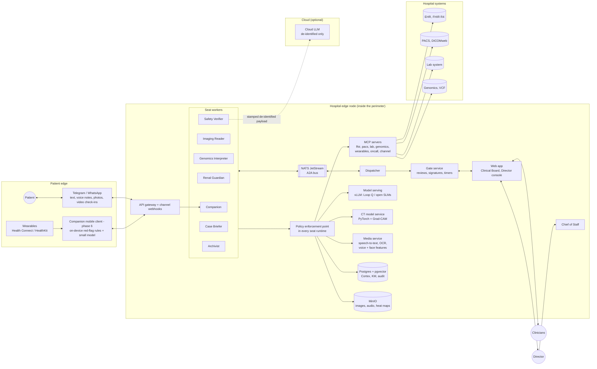
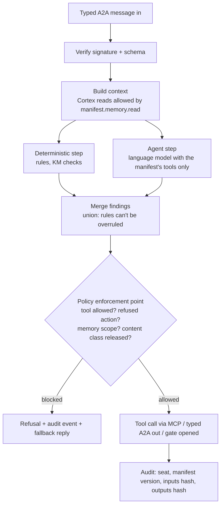
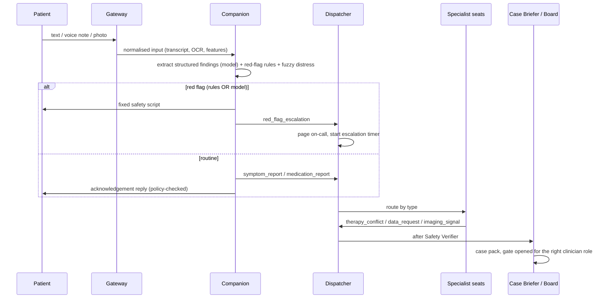
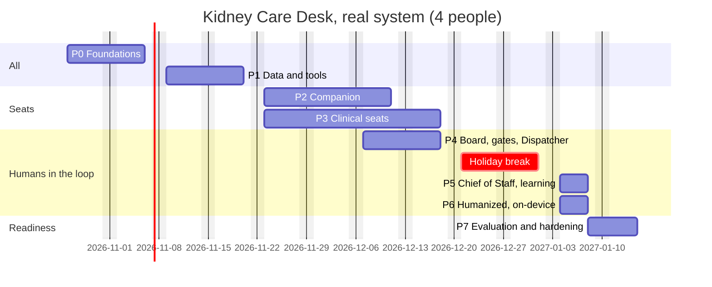

# Kidney Care Desk: architecture and implementation plan (real system)

Source: deck *Towards a New Medicine* v14, slides 16–30 (the Kidney Care Desk section).
Status of this repository: the **stage demo is built**. It is a hardcoded prototype: keyword patterns read patient messages, replies are canned text, and the 10-minute golden path is fixed. This plan covers building the **real system**: one that works for any patient, any message and any case, on real data flows.

> Clinical safety note: the real system is medical software. Until it has been through clinical validation and the regulatory steps in Phase 7, it runs on synthetic or sandbox data only.

---

## 1. What we are building, in plain words

**The problem.** A patient with several diseases gets advice from several specialists, and nobody checks how those pieces of advice combine. Example from the deck: ibuprofen is the right drug for pain and the wrong drug for a damaged kidney. Between visits, nobody watches the patient at all.

**The product.** A "care desk" of 8 AI assistants (the deck calls them *seats*). Each one has a single job, like staff in a hospital department:

| Seat | Plain job |
|---|---|
| **Companion** | Lives on the patient's phone (Telegram / WhatsApp). Talks with them in their language, reads their watch, their voice and their face, and spots emergencies. The only seat the patient ever talks to. |
| **Dispatcher** | The switchboard. Every message between seats goes through it. Pages the on-call doctor and escalates if nobody answers. |
| **Imaging Reader** | Reads kidney CT scans with the v1 AI model and produces a heat map. Reports only to doctors. |
| **Genomics Interpreter** | Reads the patient's DNA panel against medical rules (ACMG). |
| **Renal Guardian** | Watches kidney function (eGFR) and catches drugs that are harmful for the kidney. |
| **Safety Verifier** | Checks every output before it moves on: sources cited, values plausible, data anonymised before anything goes to a cloud AI. |
| **Case Briefer** | Puts everything into one summary for the doctor (SBAR "case pack"). |
| **Archivist** | Turns what doctors confirm into long-term memory rules for that patient. |

Above them sits the **Chief of Staff**, the Hospital Director's only assistant. The Director writes in plain language what to automate or what rule to add; the Chief of Staff turns it into a seat configuration (a *manifest*), and after the Director approves it, the change goes live.

**Three humans, three doors.** The patient talks only to the Companion. Doctors work only in the Clinical Board (review, edit, sign). The Director talks only to the Chief of Staff.

**The rules that matter most.**
1. The AI never diagnoses, prescribes or tells the patient a result. A doctor signs first, every time.
2. These rules are **enforced in code** (the tool is blocked), never only written in a prompt.
3. Patient data stays inside the hospital. A cloud AI is optional and only ever sees anonymised data.
4. Everything is logged: who signed, when, and based on which evidence.

**Demo vs real system, in one table**

| | Demo (built) | Real system (this plan) |
|---|---|---|
| Patients | One hardcoded patient (Marco R.) | Any number of enrolled patients |
| Understanding the patient | Keyword patterns, EN/IT | Language model extracting structured symptoms, any phrasing, several languages, voice notes and photos |
| Replies to the patient | Canned sentences | Generated, checked against policy and released content, with a fixed safety script for emergencies |
| Clinical reasoning | Scripted for 3 cases | Rules engine + Knowledge Model + grounded language model, for any combination of conditions and drugs |
| Hospital data | JSON files | FHIR, DICOM, lab and genomics systems through MCP servers |
| CT analysis | Cached v1 result | v1 model running as a service on new studies |
| Memory, gates, audit | JSON files, in-memory keys | Database, signed releases bound to logged-in clinicians, tamper-evident audit |
| Chief of Staff | Recognises a few known sentences | Compiles any job description into a validated manifest, with diff and approval |

---

## 2. What we keep from the demo

The demo is throwaway as a runtime, but several parts of it are good specifications. We carry these over:

| Keep | From | Becomes |
|---|---|---|
| Manifest schema (contract C1) | `contracts/manifestSchema.mjs` | JSON Schema + Pydantic model |
| The 10 A2A message types (contract C2) | `contracts/a2aSchema.mjs` | JSON Schema per type + golden fixtures |
| Refusal / gate / surface catalogue | `contracts/catalog.mjs` | Policy catalogue, versioned, clinically owned |
| 8 job descriptions and manifests | `seats/*.job.md`, `seats/*.manifest.json` | Seed manifests for the real seats |
| Knowledge Model rules and citations | `backend/knowledge/km.mjs` | Seed content of the structured KM (to be clinically reviewed) |
| Fuzzy distress engine | `backend/humanized/fuzzy.mjs` | Ported as is, now fed with real audio/video features |
| CT calibration (temperature scaling) | `backend/seats/clinical.mjs` | Part of the imaging service |
| Synthetic patient Marco R. | `data/marco-r/` | One of many test patients |
| UI layouts (Board, Roster, Agent page, A2A stream, Memory) | `frontend/` | Design reference for the real web app |
| The golden path | `backend/scenario/goldenPath.mjs` | One end-to-end regression test among many |

---

## 3. Architecture

### 3.1 Principles

1. **Seats, not scripts.** Each seat is an isolated agent with one manifest. The manifest is the single source of truth for what it may do.
2. **The language model proposes; deterministic code disposes.** Language models understand messages, draft text and pick tools. Every tool call, message and patient-facing text then passes a deterministic policy enforcement point. Safety never depends on the model obeying a prompt.
3. **Safety floor by union.** Red-flag detection and drug–disease checks run both as deterministic rules and through the model. A finding from either side counts; the model can add findings, never remove one.
4. **Typed messages only.** Seats exchange only the 10 schema-validated, signed A2A types. Free text between agents is rejected.
5. **Hub and spoke.** Only the Dispatcher addresses seats: one place for validation, acknowledgement, routing, timers and audit.
6. **Human gates are durable state machines.** A gated artifact stays `pending_review` until a logged-in clinician signs it. The release is a signed object that downstream guards verify.
7. **Data sovereignty by topology.** Identifiable data never leaves the hospital edge node. The cloud path accepts only payloads stamped as de-identified by the Safety Verifier.
8. **Ports and adapters.** Every external system sits behind an interface with a sandbox and a live adapter, so the whole system runs locally on synthetic data.

### 3.2 Deployment view

### 3.3 Components

| Component | Responsibility | Technology |
|---|---|---|
| **API gateway** | Auth, routing, Telegram/WhatsApp webhooks, uploads | FastAPI behind Caddy / Nginx |
| **Identity** | Clinicians, Director, IT Expert; roles per door; re-authentication to sign | Keycloak (or the hospital's IdP via OIDC) |
| **Seat runtime** | Runs one seat: agent loop, tool calls via the policy enforcement point, metering | Python worker per seat (own process / container) |
| **Policy enforcement point** | Checks tools, surfaces, peers, memory scopes, refusals and content classes against the manifest; requires signed releases | Python library used by every seat; policy catalogue in Postgres |
| **A2A bus** | Durable, ordered, acknowledged delivery of signed typed messages | NATS JetStream; A2A HTTP endpoints + Agent Cards for external peers |
| **Dispatcher** | Verifies signature + schema, routes, acknowledges, retries, dead-letters, on-call paging, escalation ladder | Python service; routing table in config |
| **Gate service** | Review queue, artifact versions, clinician edits, signatures, releases, escalation timers | Postgres state machine + scheduled worker (`SELECT … FOR UPDATE SKIP LOCKED`) |
| **Control plane** | Manifest registry: compile, validate, diff, approve, version, roll back, hot-reload | Python service + Postgres; manifests also exported to Git |
| **MCP servers** | Typed tools over FHIR, DICOMweb, lab, genomics, wearables, on-call rota, channels | Official MCP Python SDK; one server per system, owned by the IT Expert |
| **Model serving** | Edge language models per seat, per-hospital LoRA adapters, structured (JSON-schema) output | vLLM (Ollama for development); OpenAI-compatible API |
| **Cloud gateway** | Optional larger model, only for stamped de-identified payloads | Thin proxy that rejects anything without a valid stamp |
| **CT model service** | DICOM preprocessing, v1 classifier, Grad-CAM, calibration, quality / out-of-distribution check | Python, PyTorch, pydicom / SimpleITK |
| **Media service** | Speech-to-text for voice notes, OCR for lab-report photos, voice prosody and facial action-unit features | faster-whisper, a vision model or Tesseract for OCR, openSMILE, MediaPipe |
| **Knowledge Model** | Structured rules (CKD staging, drug–disease, red flags, variant classes) + retrieval over guideline text | Postgres tables + pgvector, each rule with citation and version |
| **Loop Cortex** | Evidence store (append-only, hash-chained), knowledge store (shadow → confirmed, decay), one partition per patient | Postgres schemas per partition + MinIO for blobs |
| **Web app** | Clinical Board, Director console, Roster, Agent page, A2A stream, Memory panel | React + TypeScript (Vite), server-sent events |
| **Observability** | Traces per patient episode, metrics, logs, audit export | OpenTelemetry → Grafana / Loki / Tempo |

**Why Python for the back end:** the CT model, speech, vision, MCP SDK, A2A SDK, FHIR and DICOM libraries are all first-class in Python, so one language covers seats, models and integrations. The front end stays TypeScript.

### 3.4 Anatomy of a seat

Every seat has the same structure. Only its manifest, prompt and handlers differ.

Rules for every seat:
- The model only sees tools listed in its manifest; the policy enforcement point re-checks every call anyway.
- Model output that must become a message is parsed into the A2A JSON schema (structured output). If it doesn't validate, the seat retries once and then escalates to a human; it never sends free text.
- Each seat has a timeout and a deterministic fallback, so a slow or broken model degrades to "a human will look at this", never to silence.

### 3.5 The seats in the real system

| Seat | Deterministic part | Language-model part | Output |
|---|---|---|---|
| **Companion** | Red-flag rules over the structured symptoms; fixed safety script; content guard on every reply; fuzzy distress from voice/face/words | Extract structured symptoms, medications and intents from any message (text, transcribed voice, photo OCR); run the follow-up interview; write replies in the patient's language; explain **released** clinician decisions in plain words | `symptom_report`, `red_flag_escalation`, `medication_report`, `data_delivered` |
| **Dispatcher** | Everything: verification, routing table, acks, retries, paging, escalation ladder | None | Routed messages, `acknowledgment`, pages |
| **Imaging Reader** | DICOM fetch, preprocessing, classifier, Grad-CAM, calibration, quality / OOD check | Short technical note for the radiologist (never a diagnosis) | `imaging_signal` |
| **Genomics Interpreter** | Parse VCF / panel; look up variant classes in the KM (ACMG), with no reclassification | Clinical context paragraph for the case pack | `data_delivered{genomic_context}` |
| **Renal Guardian** | eGFR trajectory, CKD stage (KDIGO), stale-data check, drug–disease rules (Beers, KDIGO) over FHIR medications + patient-reported drugs | Explain the conflict and options, with citations | `therapy_conflict`, `data_request` |
| **Safety Verifier** | Every claim has a KM citation; value ranges plausible; schema; de-identification (Presidio + custom rules) before any cloud call | Second-opinion consistency check (optional) | Verified artifact or rejection |
| **Case Briefer** | Gather the verified artifacts for the episode; SBAR template | Write the SBAR case pack, every sentence linked to evidence | `case_pack_ready`, then `clinician_decision` after signature |
| **Archivist** | Rules only from signed decisions; shadow status by default; decay | Draft the rule text from the clinician's decision | Knowledge proposals awaiting confirmation |
| **Chief of Staff** | Rule pass that extracts refusals and gates (safety floor); schema validation; diff | Turn the job description into a full manifest draft (structured output) | Manifest version awaiting Director approval |

### 3.6 Contracts (frozen in Phase 0)

| Contract | Content | Change policy |
|---|---|---|
| **C1 Manifest** | seat, location, model, skills, tools, surfaces, memory R/W, refuses, gates, a2a_peers, artifact, unit, job_description | Semver; any change to refuses / gates needs clinical sign-off |
| **C2 A2A messages** | The 10 types, each with a JSON Schema, envelope (id, from, to, patient, correlation, idempotency key, timestamp) and Ed25519 signature | Semver; golden fixtures per type |
| **C3 Policy catalogue** | Refusal → blocked actions + content classes; gates → signer role; surfaces → tools | Clinically owned; every entry has a test proving it blocks |
| **C4 CT service API** | `POST /classify {study_uid}` → `{label, p_raw, p_calibrated, heatmap_ref, cam_metrics, quality, model_version}` | Versioned with the model |
| **C5 Release** | Signed by the clinician's key, bound to their identity, references the artifact hash and version | Fixed |
| **C6 MCP tool schemas** | Input / output schema of every tool on every server | Versioned per server |

### 3.7 Main flows

**Patient message (any content)**

**Clinician decision:** the clinician opens the case pack on the Board → edits → re-authenticates and signs → the gate service stores a signed release → the Case Briefer emits `clinician_decision` → the Companion explains it in the patient's language (content guard checks the release) → the Archivist drafts rules in shadow mode → the clinician confirms.

**New imaging study:** PACS notifies (DICOMweb poll or Orthanc webhook) → Imaging Reader → CT service → `imaging_signal` → Safety Verifier → Case Briefer (with genomic context) → radiologist gate. If the patient asks before release, the Companion can only say the images are being reviewed.

### 3.8 Data model (core tables)

| Table | Key fields |
|---|---|
| `patient` | id, FHIR id, language, channel ids, consent status, care team |
| `episode` | id, patient, opened_at, status, correlation id |
| `a2a_message` | id, type, from, to, patient, episode, payload (JSONB), signature, schema version, acked_at |
| `artifact` | id, type, episode, version, content (JSONB), hash, status (`draft`, `pending_review`, `released`, `rejected`) |
| `gate` | id, artifact, signer role, assigned to, deadline, escalation level, status |
| `release` | id, artifact hash, clinician id, signature, signed_at, edits |
| `evidence` | id, partition (patient), kind, blob ref, sha256, prev_hash, received_at (append-only) |
| `knowledge` | id, partition / scope L0–L3, subject, predicate, value, confidence, source, confirmer, status, version |
| `manifest` | seat, version, body (JSONB), diff, compiled_by, approved_by, active |
| `km_rule` | id, kind (ckd_stage, drug_disease, red_flag, variant), condition, effect, citation, version, reviewed_by |
| `audit_event` | id, ts, actor, seat, manifest version, action, inputs hash, outputs hash, decision |

**Right to erasure:** delete the patient partition in `evidence` and `knowledge`, and any patient-specific adapter. Shared model weights never contain patient data.

### 3.9 Security

- OIDC login for every human; roles: `director`, `clinician:{nephrology, radiology, urology-oncology, genetics}`, `it_expert`.
- Signing a gate requires re-authentication; the release is signed with a key held in Vault and bound to the clinician's identity.
- Per-seat keys in Vault; seats sign every A2A message; Agent Cards signed (JWS).
- mTLS between services on the edge node; no inbound internet except channel webhooks through the gateway.
- Encryption at rest (Postgres, MinIO); secrets never in `.env` outside development.
- Threat model covering prompt injection through patient messages and documents: the policy enforcement point, not the prompt, is the boundary; adversarial tests in CI.

---

## 4. Implementation plan

**Chosen team: 4 people, 10 working weeks.** (The 2-developer option would take about 16 weeks for the same scope.)

| Role | Code | Owns |
|---|---|---|
| **Platform engineer** (tech lead) | BE | Contracts, seat runtime, policy enforcement point, A2A bus, Dispatcher, gate service, Cortex, control plane, Chief of Staff |
| **ML engineer** | ML | Model serving, model gateway, CT service, media service (speech, OCR, voice/face features), extraction and red-flag models, de-identification, evaluation harness |
| **Full-stack / front-end engineer** | FE | Web app (Clinical Board, Director console, Roster, Agent page, A2A stream, Memory), API gateway, identity and roles |
| **Integration and DevOps engineer** | INT | Edge-node infrastructure, CI/CD, migrations, sandboxes, synthetic data, MCP servers, channels (Telegram / WhatsApp), paging, rule-based clinical seats |

Plus a **clinical lead** (nephrologist), about 0.5 day a week in Phases 0–1 and 1–2 days a week from Phase 2 on. Estimates are indicative.

The Phase 0 tickets, per person, are in [PHASE0_TICKETS.md](PHASE0_TICKETS.md).

### Phase 0: Foundations

| Task | Done when |
|---|---|
| Monorepo (`services/`, `seats/`, `mcp/`, `web/`, `contracts/`, `infra/`), Git, CI on every push | CI green with lint, types, tests |
| Docker Compose for the edge node: Postgres + pgvector, NATS, MinIO, Keycloak, vLLM / Ollama, HAPI FHIR, Orthanc | `docker compose up` brings the whole stack up locally |
| Port contracts C1–C3 to JSON Schema + Pydantic, with golden fixtures | Contract tests pass |
| Seat runtime + policy enforcement point + audit events | A test seat is blocked from a refused tool, a wrong peer and a wrong memory layer |
| A2A bus on NATS with signing, verification, ack, retry, dead-letter, idempotency | Killing a worker mid-flow loses no message (test) |

### Phase 1: Data and tools

| Task | Done when |
|---|---|
| MCP servers: `fhir` (Patient, Condition, Observation, MedicationStatement), `pacs` (DICOMweb), `lab`, `genomics` (VCF / panel), `wearables`, `oncall`, `channel` | Each server passes its tool-schema tests against the sandboxes |
| Synthetic population: 50+ patients from Synthea with CKD / RCC / hypertension mixes, plus Marco R.; de-identified KiTS19 CTs in Orthanc | Seed script loads everything into HAPI + Orthanc |
| Knowledge Model: structured rule tables seeded from the demo KM; guideline passages (KDIGO, EAU, ACMG, Beers) indexed for retrieval with citations | KM tests: staging, conflicts, red flags, variant lookups |
| Cortex: evidence (hash-chained) and knowledge stores, partitions, erasure | Chain verification and erasure tests pass |

### Phase 2: Patient side, the Companion

| Task | Done when |
|---|---|
| Telegram (then WhatsApp) webhooks; text, voice notes, photos | Messages from a test phone reach the Companion |
| Media service: speech-to-text, lab-report OCR into structured values | OCR accuracy measured on a labelled set of report photos |
| Structured extraction with the edge model (symptoms, severity, drugs, intents) in EN / IT / FR / AR | Extraction F1 measured on a labelled message set |
| Red-flag engine (rules ∪ model) with the fixed safety script | Red-flag recall ≥ 0.98 on the evaluation set; no false negative on the critical patterns |
| Interview policy (follow-up questions until the picture is complete) | Scenario tests over 30+ scripted conversations |
| Reply generation + content guard + release check | Zero unreleased imaging / diagnosis / dose content in 1,000 adversarial replies |

### Phase 3: Clinical seats

| Task | Done when |
|---|---|
| Renal Guardian over FHIR: trajectory, staging, stale-data `data_request`, drug–disease conflicts for any drug list | Correct on a clinician-built table of 50+ drug × condition cases |
| CT service from the v1 model: DICOM pipeline, Grad-CAM, calibration fitted on the validation set, quality / OOD | Calibration error (ECE) reported; OOD flags on non-kidney or low-quality studies |
| Imaging Reader triggered by new studies in PACS | New study → signal on the Board, without manual steps |
| Genomics Interpreter over VCF / panels with KM variant classes | Known variants classified as in the KM; unknown ones reported as such, never guessed |
| Safety Verifier: citation check, plausibility, de-identification, cloud stamp | Cloud gateway rejects unstamped payloads; de-id recall measured on a PHI test set |
| Case Briefer: SBAR with sentence-level evidence links | Clinician rates 20 case packs; every claim links to evidence |

### Phase 4: Clinical Board, gates and Dispatcher

| Task | Done when |
|---|---|
| Web app: login, review queue per role, case pack editor, evidence viewer (CT + heat map, labs chart, DNA), sign | A clinician completes review and signature end to end |
| Gate service: assignment by role and on-call rota, deadlines, escalation ladder, reminders | Escalation fires on time in tests with a simulated clock |
| Real paging (SMS / push) behind a feature flag | Page received on a test device |
| A2A stream and audit views | Every message and signature visible and exportable |

### Phase 5: Chief of Staff and the learning loop

| Task | Done when |
|---|---|
| Compiler: job description (any language) → manifest draft (structured output) → rule-pass safety floor → validation | 30 job descriptions compile to valid manifests; refusals never dropped |
| Manifest lifecycle: diff, Director approval, versioning, rollback, hot-reload of the seat worker | Change goes live without restarting other seats |
| Seat performance report for the Director (volumes, refusals, gate turnaround, errors) | "How is nephrology follow-up doing?" answered from real metrics |
| Archivist: shadow rules from signed decisions, confirmation on the Board, decay, reuse in the next episode | A confirmed rule changes the next episode's behaviour (test) |

### Phase 6: Humanized AI and on-device

| Task | Done when |
|---|---|
| Voice features from voice notes (prosody, rate, tremor) and facial action units from short video check-ins → fuzzy distress | Distress score driven by real input; validated against labelled samples |
| Companion mobile client (optional): on-device red-flag rules + small quantised model, offline | Red flag detected with the network off |
| Wearables integration (Health Connect / HealthKit) | 90-day series from a real device in Cortex |

### Phase 7: Evaluation, hardening and readiness

| Task | Done when |
|---|---|
| Evaluation harness per seat with versioned datasets; runs in CI on every model / prompt / manifest change | Dashboard of metrics per seat and per version |
| Adversarial suite: prompt injection through messages, OCR text and documents; jailbreak attempts on every refusal | All refusals hold |
| Load and failure tests: 500 enrolled patients, model down, PACS down, bus partition | System degrades to human review, never loses messages |
| Security review and penetration test | Findings fixed |
| Clinical validation with the clinical lead on synthetic + retrospective cases | Written sign-off |
| Regulatory groundwork: DPIA (GDPR / Law 09-08), EU AI Act high-risk file, IEC 62304 lifecycle, MDR classification of red-flag triage and imaging support, hazard log | Documents ready for a pilot decision |

### Timeline (4 people)

Start Monday 2026-10-26. Ten working weeks, with the holiday break (2026-12-21 → 2027-01-01) left out, so the plan ends on **2027-01-15**. Phases 2 and 3 run in parallel, and so do Phases 4, 5 and 6.

| Week | Dates | BE (platform) | ML | FE (full-stack) | INT (integration / DevOps) |
|---|---|---|---|---|---|
| 1–2 | Oct 26 – Nov 6 | **P0** contracts, signing, bus, seat runtime, policy enforcement, audit | **P0** model serving, gateway, v1 CT intake, CT service skeleton, eval harness | **P0** web scaffold, identity, API gateway, live stream view, Board wireframes | **P0** edge stack, CI, migrations, synthetic data, KiTS19, first MCP server |
| 3–4 | Nov 9 – Nov 20 | **P1** Cortex stores, KM rule tables, Dispatcher routing | **P1** KM retrieval index, CT preprocessing + Grad-CAM on DICOM | **P1** evidence viewers (CT + heat map, labs chart, DNA) on sandbox data | **P1** all MCP servers, Synthea cohort, seed scripts |
| 5–7 | Nov 23 – Dec 11 | **P2** Companion seat: interview policy, reply generation, content guard, release check | **P2 + P3** media service, extraction, red-flag model, CT calibration + OOD, de-identification | **P3/P4** review queue, case pack editor, signing flow | **P2 + P3** Telegram / WhatsApp, Renal Guardian, Genomics Interpreter, Imaging Reader trigger |
| 8 | Dec 14 – Dec 18 | **P4** gate service, escalation ladder | **P3** Safety Verifier, Case Briefer generation | **P4** gates on the Board, A2A stream + audit views | **P4** on-call rota, paging |
| — | Dec 21 – Jan 1 | *holiday break* | | | |
| 9 | Jan 4 – Jan 8 | **P5** Chief of Staff compiler, manifest lifecycle, Archivist | **P6** voice and face features → fuzzy distress | **P5** Director console, Agent page (diff + approve), Roster, Memory panel | **P6** wearables integration; **P7** load-test setup |
| 10 | Jan 11 – Jan 15 | **P7** failure tests, security fixes | **P7** full evaluation run, adversarial suite | **P7** end-to-end UI tests, accessibility | **P7** load tests, penetration-test support, release |

**Schedule risk:** Phases 5 and 6 get one week each in this plan, so they are the tightest. If anything slips, the on-device Companion client (Phase 6) moves after 2027-01-15 first, because a first pilot doesn't need it.

### Milestones

| Milestone | What it proves |
|---|---|
| **M1, end of P1** | Platform, bus, policy enforcement and all hospital data reachable through MCP |
| **M2, end of P2** | A real conversation on a phone, any phrasing, red flags caught and escalated |
| **M3, end of P4** | All three deck scenarios work for patients they were not scripted for, with real signatures on the Board |
| **M4, end of P5** | The Director changes the desk in plain language; the desk learns from confirmed decisions |
| **M5, end of P7** | Measured, secured and documented: ready for a pilot decision |

---

## 5. Evaluation and quality

A real clinical agent system is only as good as its measurements. Every seat ships with a dataset and a threshold, and CI blocks a regression.

| Seat / area | Metric | Target (initial) |
|---|---|---|
| Companion red flags | Recall on critical patterns / precision | ≥ 0.98 / ≥ 0.70 |
| Companion extraction | F1 on symptoms, drugs, severity | ≥ 0.90 |
| Content guard | Leaks of unreleased imaging / diagnosis / dose | 0 |
| Renal Guardian | Agreement with the clinician table on conflicts | ≥ 0.95 |
| Imaging Reader | AUROC, calibration error (ECE), OOD detection | Reported per model version; ECE ≤ 0.05 |
| Safety Verifier | De-identification recall on PHI test set | ≥ 0.99 |
| Case Briefer | Claims with valid evidence links; clinician rating | 100% linked; ≥ 4/5 |
| Chief of Staff | Valid manifests; refusals preserved | 100% / 100% |
| Platform | Messages lost under failure injection | 0 |

Test levels: contract tests, unit tests, seat tests with recorded model outputs, end-to-end scenario tests (including the demo's golden path), adversarial tests, load tests, and clinician review sessions.

---

## 6. Non-functional requirements

| Requirement | Target |
|---|---|
| Red flag → safety script to the patient | p95 under 5 s on the hospital node; under 1 s on device (Phase 6) |
| Red flag → on-call paged | p95 under 60 s |
| Routine message → reply | p95 under 10 s |
| CT study → signal on the Board | under 2 minutes |
| Availability of the patient channel | 99.5% (edge node + restart policy) |
| Scale per edge node | 500 enrolled patients, 50 concurrent conversations |
| Data leaving the perimeter | only stamped de-identified payloads |
| Audit | every message, tool call, refusal, signature; tamper-evident; retained per hospital policy |

---

## 7. Risks

| Risk | Mitigation |
|---|---|
| Language model misses a red flag | Rules ∪ model union; recall threshold in CI; fixed safety script; clinician review of the red-flag set |
| Prompt injection via patient messages or documents | Policy enforcement point outside the model; structured outputs only; adversarial suite |
| Edge models too weak for some tasks | Seat-level evaluation; LoRA fine-tuning per hospital; optional cloud model for de-identified tasks only |
| v1 CT model doesn't generalise to new scanners | Quality / OOD check; calibration on local data; signal is always reviewed by a radiologist |
| Hospital system access (FHIR, PACS) delayed | Sandboxes (HAPI, Orthanc) behind the same MCP interfaces; live adapters swapped in later |
| Clinical content wrong or outdated | KM rules versioned with citation and reviewer; clinical lead owns the catalogue |
| Regulatory scope bigger than expected | Phase 7 groundwork early; keep the demo label "research prototype" until classified |
| Small team, wide scope | Phases ordered so each milestone is usable; Phase 6 is optional for a first pilot |

---

## 8. Decisions needed

1. ~~**Team size**~~ decided: 4 people, 10 working weeks (see section 4).
2. **Loop platform:** build the runtime as described here, or run the seats on Loop Nexus / Orchestra / Q / Cortex if their APIs are ready? The manifests and contracts are the same either way.
3. **Models:** which edge models (Loop Q, or open models such as Qwen) and is a cloud model allowed for de-identified tasks?
4. **Target hospital and jurisdiction:** EU (AI Act + MDR), Morocco (Law 09-08), or both. This fixes the Phase 7 scope.
5. **Clinical lead:** who reviews the KM, the red-flag set and the case packs, and how many hours a week?
