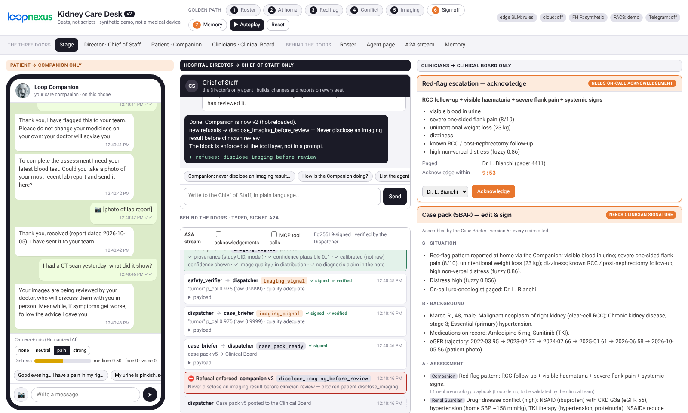

# Kidney Care Desk · v2

**Loop AI Labs — demo for "Towards a New Medicine"** (deck v14, slides 17–30).
Eight clinical "seats" compiled from plain-language job descriptions. They talk in typed, signed A2A messages, reach hospital systems through MCP, remember in Loop Cortex, read the patient with Humanized AI, and stop at human gates enforced at runtime.
It is the same case as v1 (kidney, RCC, DNA, EHR, CT, Telegram), rebuilt on the Agent Desk architecture.

> Research prototype on **synthetic data**. Not a medical device.



---

## Run it (two commands, zero dependencies)

```bash
cd kidney-care-desk
npm start                # → http://localhost:5173
```

You only need **Node.js ≥ 20**: no `npm install`, no database, no network.
Press **▶ Autoplay**, or run steps 1–7 by hand on stage.

```bash
npm test                 # 17 tests: contracts, signatures, compiler, refusals, fuzzy, KM, Cortex, MCP, e2e (EN + IT)
npm run demo:cli         # the whole golden path in the console, no browser
DEMO_LANG=it npm start   # same demo with an Italian-speaking patient and Director
```

The demo runs in **English** by default. Agents always reply in the language they are addressed in, so you can switch language live: type to the Companion or to the Chief of Staff in Italian and they answer in Italian.

## The three doors (one per human)

| Human | Talks only to | Where |
|---|---|---|
| **Hospital Director** (or a delegated head of department) | **Chief of Staff**: creates and changes agents in plain language, reports how they perform | *Director* tab |
| **Patient** | **Companion**: Telegram/WhatsApp, voice and face, in his own language | *Patient* tab |
| **Clinicians** | **Clinical Board**: the Case Briefer's case packs, signatures at every gate | *Clinical Board* tab |

The **Stage** tab shows the three doors side by side, with the A2A stream in the middle. This is the view to project.

## The golden path (≈10 minutes)

1. **Roster.** The Director writes to the Chief of Staff: *"Companion: never disclose an imaging result to the patient before the doctor has reviewed it."* The sentence is compiled into `refuses: disclose_imaging_before_review` (Companion v2, hot-reloaded).
2. **At home, 21:40.** Marco plays it down (*"nothing serious"*), but his face (PSPI) and voice say otherwise: the fuzzy engine flags *under-reporting*.
3. **Red flag.** The pattern is recognised on the phone, even offline. The Companion sends the fixed safety script plus a `red_flag_escalation`; the Dispatcher pages the on-call uro-oncologist, with a timer and an escalation ladder.
4. **Conflict.** Marco is taking ibuprofen. The Renal Guardian sees an eGFR from 122 days ago and sends a `data_request`; the patient sends a photo of his lab report (OCR); then NSAID × CKD G3a × hypertension × TKI → `therapy_conflict`, which goes through the Safety Verifier.
5. **Imaging.** The CT reaches PACS. The Imaging Reader returns a signal, a heat map and a calibrated confidence, **to the Board only**. Marco asks for the result → **refusal enforced**.
6. **Sign-off.** The clinician edits and signs the SBAR case pack (Ed25519). Only signed content is "released" to the Companion, which explains it to Marco.
7. **Memory.** The Archivist proposes rules in *shadow* mode; the clinician confirms them; in the next episode the Companion uses them.

## What is inside

```
contracts/      CONTRACT 1 manifest · CONTRACT 2 ten A2A messages + Ed25519 signing · catalogue of refusals/gates/MCP surfaces
seats/          8 × job description (.job.md) + compiled manifest (.manifest.json)
backend/
  server.mjs        HTTP + SSE + REST for the three doors + MCP over HTTP + A2A agent cards
  desk.mjs          wires everything together (keys, bus, MCP, Cortex, Board, runtime, seats)
  compiler.mjs      Chief of Staff: plain language (EN/IT/FR) → manifest → hot-reload
  runtime/          A2A bus (hub-and-spoke) · guard (runtime refusals) · Board (signed human gates) · runtime
  seats/            Companion · Dispatcher · Imaging Reader · Genomics Interpreter · Renal Guardian ·
                    Safety Verifier · Case Briefer · Archivist · Chief of Staff
  mcp/              MCP protocol (JSON-RPC 2.0) + 10 servers: fhir, pacs, imaging, lab, genomics,
                    wearables, oncall, channel, km, cortex
  knowledge/km.mjs  Knowledge Model: KDIGO, drug–disease conflicts, red flags, variants (all cited)
  humanized/        clinical NLU (EN/IT) · neuro-fuzzy engine (PSPI + voice + words → distress)
  memory/cortex.mjs hash-chained evidence store + knowledge store (shadow → confirmed, decay, erase)
  models/gateway.mjs any OpenAI-compatible LLM (edge; cloud only with de-identified data)
  scenario/         golden path (shared by the UI, the CLI and the tests), English and Italian scripts
frontend/       no-build SPA: Stage, Director, Patient, Clinical Board, Roster, Agent page, A2A stream, Memory
bin/mcp-stdio.mjs  every MCP server usable from any MCP host over stdio
data/marco-r/   synthetic patient: FHIR R4, NGS panel (v1), CT + v1 inference, lab report (EN + IT), on-call rota
tests/          unit + end-to-end
```

## Connecting real systems (synthetic → live, no code changes)

Copy `.env.example` to `.env` and set only what you need:

| Variable | What goes live |
|---|---|
| `DEMO_LANG` | `en` (default) or `it`: demo script, lab report and draft wording |
| `EDGE_LLM_BASE_URL` / `EDGE_LLM_MODEL` | edge SLM (Ollama/vLLM, e.g. `qwen3:4b` or your Loop Q model): compiler skills and case-pack narrative |
| `CLOUD_LLM_*` | teacher/fallback (e.g. Kimi): accepts **only** payloads stamped as de-identified by the Safety Verifier |
| `FHIR_BASE_URL` | real EHR (HAPI FHIR). `node scripts/seed-live.mjs` loads Marco |
| `DICOMWEB_URL` | real PACS (Orthanc DICOMweb) |
| `CT_MODEL_URL` | **your v1 CT classifier**: `POST {image_url}` → `{label, confidence, cam_metrics, heatmap_url}` |
| `TELEGRAM_BOT_TOKEN` | **your v1 bot**: long polling, real messages go into the Companion |

`docker compose --profile live up -d` starts Ollama, HAPI FHIR and Orthanc next to the desk.

## What is real and what is simulated

**Real:**
- Ed25519 signing and verification of every message;
- schema validation;
- refusals at the tool layer and on content;
- signed human gates;
- the hash chain of the evidence store;
- the EN/IT/FR compiler and the fuzzy engine;
- the MCP protocol (in-process, HTTP, stdio) and A2A agent cards;
- lab-report OCR (the parser), Knowledge Model rules with citations, confidence calibration;
- escalation with timers.

**Simulated or still to connect:**
- face and voice features: presets on the phone instead of the camera;
- CT inference: cached from v1 until you set `CT_MODEL_URL`;
- wearables: deterministic synthetic series;
- paging: logged, not sent;
- the SLM: rule path until you set `EDGE_LLM_*`.

The clinical rules in the Knowledge Model are a demo base. They must be validated by the clinical team before any real use.

See `docs/ARCHITECTURE.md` (mapping to the slides) and `docs/INTEGRATION.md` (v1 → v2, Loop Orchestra).
